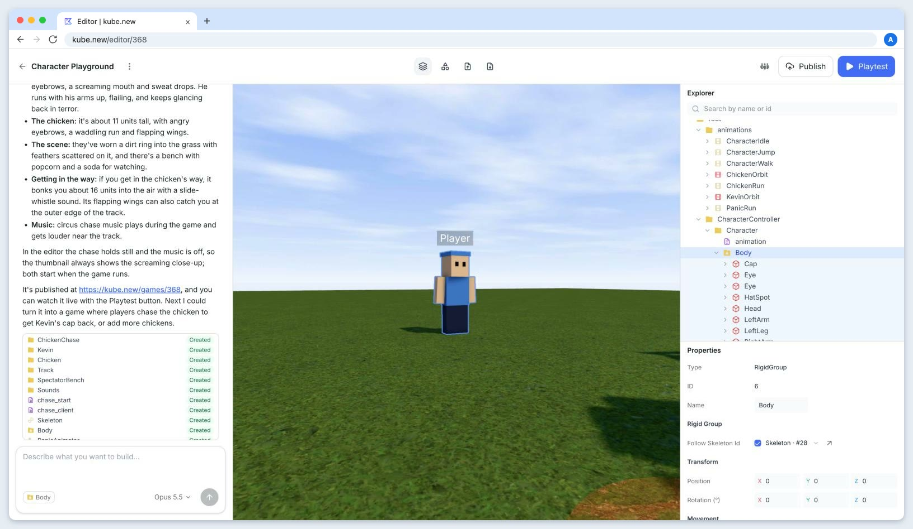
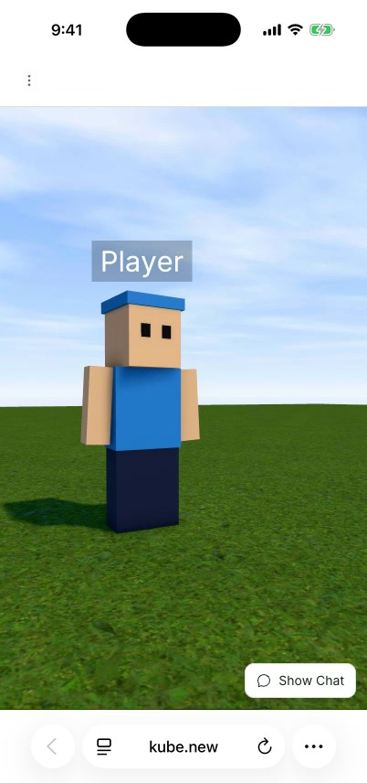
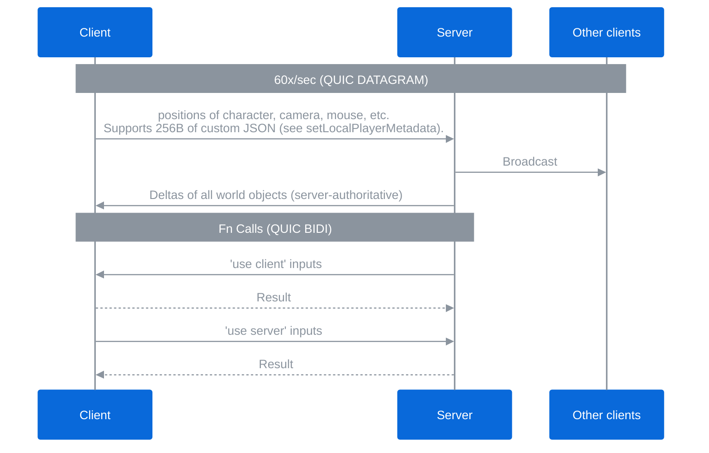

<div align="center">
	
</div>

# Welcome to Kube.

[Kube.new](https://kube.new) is a platform where you make games without coding. 

The underlying game engine is made entirely from scratch in Rust. 

This allows us to cross-compile to the browser (to edit games) and as a native desktop app (to play games).

- 🧭 [Website](https://kube.new)
- 🔨 [Docs](https://kube.new/docs) 
- 👨‍💻 [Blog](https://kube.new/blog)


 
 
 


## Features

### Native desktop app

Our desktop app feels as fast as a native game because we use `wgpu` to compile our custom shaders to Metal/Vulkan/etc.

  

### An in-browser editor

You can edit from any browser, including your phone (or embedded in Claude or Codex)!

 


### Edit live with friends, or via MCP

The editor server allows invite codes so that you can edit with your friends.


#### Editing live with friends:

All edits are synced when editing with friends.

  

#### Playtesting with friends:

The editor server lets you playtest live with friends too!

  


#### Editing via MCP server:

You can share your live editor with an AI, the same exact way you share it with friends.


### WASM cross-compiling
Our Rust renderer runs in the browser as WASM, and also natively in the desktop app. This means users get the best of both worlds: the performance of a desktop app, and the convenience and embeddability of a browser editor.

 

### Simple object types

We have a collection of [object_types.rs](./crates/game_types/src/object_types.rs) that are extremely simple to understand and "Turing-complete" for building games. Our [API](https://kube.new/docs) covers all the types and more.

###  Scripting in TS

Scripts all run in TypeScript (see [the blog](https://kube.new/blog/why-ts)), and can live on both the server and the client.

We implemented `'use server'` and `'use client'` so that scripts can talk with each other across the network ([blog here](https://kube.new/blog/use-server)).

### Turing Complete

You can make anything in Kube. Here's Mario, created by Opus 5.5. Everything you see is really running on Kube's TypeScript scripting API and game engine (and the game even works in multiplayer)!

  


## Networking

### Fast QUIC networking

The engine is built on QUIC datagrams (UDP) at 60 ticks a second.

In fact, most of the netcode - [`server_networking.rs`](./crates/server/src/server_networking.rs) - was written by hand (the project was started before AI was good at networking and 3D)! Here's a deep dive [blog on networking](https://kube.new/blog/networking).


### Basic Architecture

Kube is server-authoritative. 





We have a server-authoritative architecture where players' worlds live slightly in the past so that changes are synchronously applied (see the [Networking blog](https://kube.new/blog/networking)). We simply timestamp all changes (using NTP) and interpolate locally. There is a network-layer filter to guarantee changes are commutative. Scripting allows the game to have lag compensation, client or server-side collision detection, and server validation. 

There are a few games where something like the Quantum Photon architecture would be useful (eg the Mario example). We allow the AI to support a state-space variant of this (rather than input-space) by using [`setLocalPlayerMetadata`](https://kube.new/docs#PlayerService), which is broadcast every tick by the client (see the above diagram).


## Codebase

This repo contains all the code for the kube.new, including the website, desktop app, game servers, and editor servers.

See the top-level READMEs for more information about some of the subsystems.

### Rust crates
```bash
crates/
  # desktop app
  client/
  
  # web
  render_web/
  
  # server
  editor_server/ # wraps server
  server/
  
  # common
  game_types/
  profanity/
  render_core/
  shared/

```

### JS packages
```bash
packages/
  kube-ts-api/
  play-webview/ # React GUI overlay
  website/
```

### Packaging
```
packaging/{client|server|editor-server}/
```


### Useful scripts
```bash
scripts/
  install_deps.sh
  run_website.sh       # run website, with editors and playtests as you open games
  run_only_website.sh  # run website only (less overhead)
  stage_test_files.sh
```


## Community & Support

- 💬 [Discord](https://discord.gg/4uZsGRtGT)
- 🐛 support@kube.new


