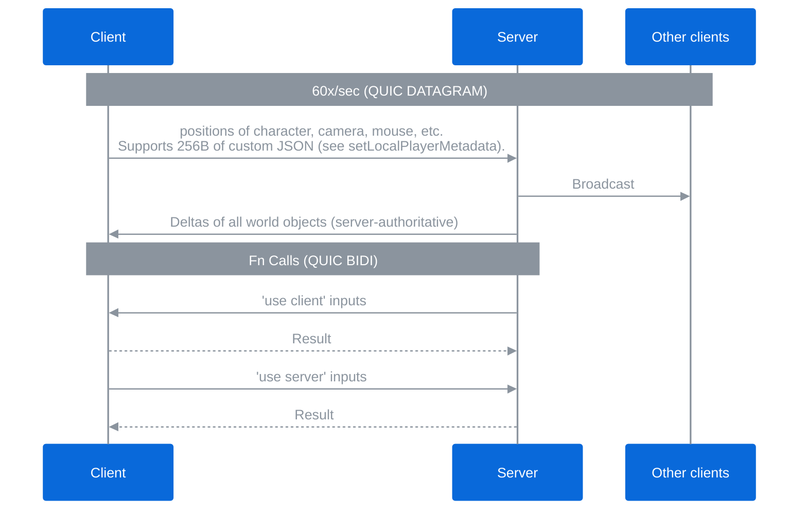
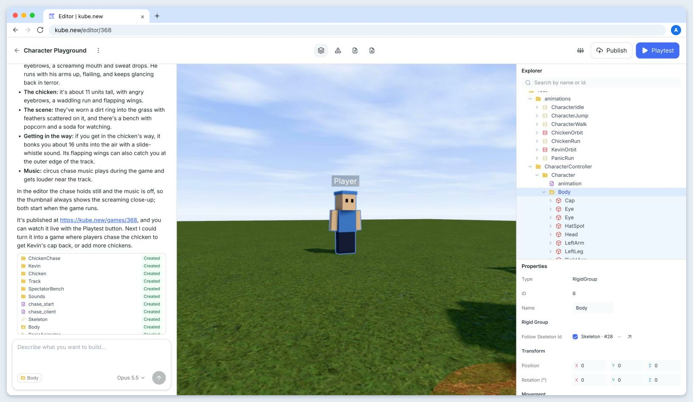
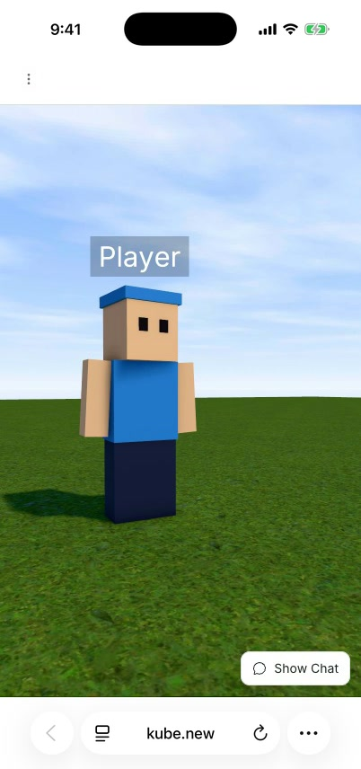

<div align="center">
	
</div>


# Welcome to Kube.

[Kube.new](https://kube.new/) is a platform where you make games without coding.

The underlying game engine is made from scratch in Rust! That includes custom wgpu shaders that compile to Metal/Vulkan, custom QUIC networking protocols, object types, a V8 TS scripting API & Rust/JS bridge, headless server containers, desktop deeplinks and web auth syncing,  agent sandboxes/harnesses, etc!

Building an engine from scratch is now possible with AI, and we picked it to have a much better understanding of hosting, auth, assets, and security without having to build a giant harness on eg Godot and hack through a big codebase.

We cross-compile Kube to both the browser (to edit games) and as a native desktop app (to play games).

- 🧭 [Website](https://kube.new)
- 🔨 [Docs](https://kube.new/docs) 
- 👨‍💻 [Blog](https://kube.new/blog)


 
 
 


## Networking

### Fast QUIC Networking

The engine is built on QUIC datagrams (UDP) at 60 ticks a second.

In fact, most of the netcode - [`server_networking.rs`](./crates/server/src/server_networking.rs) - was written by hand (the project was started before AI was good at networking and 3D)! Here's a deep dive [blog on networking](https://kube.new/blog/networking).


### Basic Architecture

Kube is server-authoritative. 





We have a server-authoritative architecture where players' worlds live slightly in the past so that changes are synchronously applied (see the [Networking blog](https://kube.new/blog/networking)). We simply timestamp all changes (using NTP) and interpolate locally. There is a network-layer filter to guarantee changes are commutative. Scripting allows the game to have lag compensation, client or server-side collision detection, and server validation. 

There are a few games where something like the Photon Quantum architecture would be useful (eg the Mario example). We allow the AI to support a state-space variant of this (rather than input-space) by using [`setLocalPlayerMetadata`](https://kube.new/docs#PlayerService), which is broadcast every tick by the client (see the above diagram). This allows, for example, for games like [Live Canvas](https://kube.new/games/397) below:


## Features


### Simple Object Types

We have a collection of [object_types.rs](./crates/game_types/src/object_types.rs) that are extremely simple to understand and "Turing complete" for building games. Our [API](https://kube.new/docs) covers all the types and more.

These integrate into the physics engine (built on Rapier) naturally. We built a large harness on top of Rapier; for example, [RigidGroup](https://kube.new/docs#rigidGroup) is the primitive we built that allows you to make a union rigid body, with methods to animate it using a [Skeleton](https://kube.new/docs#skeleton), [PropertyAnimator](https://kube.new/docs#propertyAnimator), or [Tween](https://kube.new/docs#tween). We also handle interpolation changes and physics sweeping automatically for you. Objects can be teleported like `obj.location.x = 10`, or with [ObjectService](https://kube.new/docs#ObjectService). See our full API for more details.

### Native Desktop App

Our desktop app feels as fast as a native game because we use `wgpu` to compile our custom shaders to Metal/Vulkan/etc.

  

### Browser Editor

You can edit from any browser, including your phone (or embedded in Claude or Codex)!

 


### Edit Live with Friends, or via MCP

The editor server allows invite codes, so that you can (1) edit with your friends, (2) playtest live with friends, and (3) share the live server with an agent via MCP.


(1) 


(2)


(3)


**Getting an invite code:**


### WASM Cross-Compiling
Our Rust renderer runs in the browser as WASM, and also natively in the desktop app. This means users get the best of both worlds: the performance of a desktop app, and the convenience and embeddability of a browser editor.

Most of our renderer code lives [here](https://github.com/andrewpareles/kube/blob/master/crates/render_core/src/renderer.rs). The organization was first created by humans and is now entirely written by AI.

 


### Scripting in TS

Scripts all run in TypeScript (see [the blog](https://kube.new/blog/why-ts)), and can live on both the server and the client.

We implemented `'use server'` and `'use client'` so that scripts can talk with each other across the network ([blog here](https://kube.new/blog/use-server)).

The Rust/JS bridge is was designed by humans but is now entirely maintained by AI. You can see it [here](https://github.com/andrewpareles/kube/blob/master/crates/shared/src/game/jsRustConversions.rs). 

The code for running V8 and passing in high-level data structures is [here](https://github.com/andrewpareles/kube/blob/master/crates/shared/src/game/jsRuntime.rs).

### Turing Complete

You can make anything in Kube. Here's Mario, created by Opus 5.5. Everything you see is really running on Kube's TypeScript scripting API and game engine (and the game even works in multiplayer)!

  


## Codebase

This repo contains all the code for the kube.new, including the website, desktop app, game servers, and editor servers.

See the top-level READMEs for more information about some of the subsystems.

### Rust Crates
```bash
crates/
  # desktop app
  client/
  
  # web
  render_web/
  
  # server
  editor_server/ # wraps server
  server/
  
  # common
  game_types/
  profanity/
  render_core/
  shared/

```

### JS Packages
```bash
packages/
  kube-ts-api/
  play-webview/ # React GUI overlay
  website/
```

### Packaging
```
packaging/{client|server|editor-server}/
```


### Useful Scripts
```bash
scripts/
  install_deps.sh
  run_website.sh       # run website, with editors and playtests as you open games
  run_only_website.sh  # run website only (less overhead)
  stage_test_files.sh
```


## Community & Support

- 💬 [Discord](https://discord.gg/4uZsGRtGT)
- 🐛 support@kube.new


